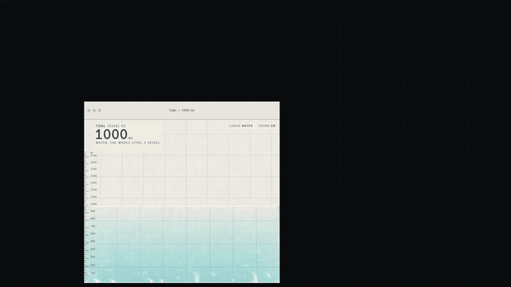

Tidal is a web toy: one body of water that lives across all your browser windows, driven by where the windows are on your screen.

## Try it

```bash
npm ci
npm run dev
```

Open http://localhost:5173 in Chrome and press **+ Vessel**. To host it yourself, see [DEPLOY.md](DEPLOY.md).

## What you can do

- Add vessels (popup windows) and push them together so water pours from one into the next.
- Drag a window to slosh the water in it.
- Close a window and its water rains into the others.
- Float a tank: a picture-in-picture tank that stays on top of everything else.
- Perform: the windows move themselves and pour into each other.
- Liquids: water, mercury, honey, and two inks that mix.
- Stage: a dark backdrop behind the vessels.
- Span: put vessels on a second screen (needs the Window Management permission).
- Tilt a phone to slosh the water.
- Keyboard: V add vessel, F float, P perform, L liquid, S sound, M span, G stage, arrow keys slosh, Escape stops Perform.

## How it works

- **The world is screen space.** Every window publishes the rectangle of its viewport, in screen coordinates, over a BroadcastChannel. Together those rectangles are the world.
- **Calibration.** A page cannot ask where its content area sits inside the outer window. I first estimate it from `outerWidth`/`innerWidth` and friends, then replace the estimate with the exact offset the first time a pointer event gives both `screenX/Y` and `clientX/Y`.
- **One leader.** Exactly one visible window simulates everything. Leadership is a Web Lock; the browser hands it to the next waiting window when the holder closes or crashes. Hidden windows resign.
- **The solver.** A 2D MLS-MPM (APIC) solver on WebGPU: 100,000 particles on a 1024 by 512 grid of 6 px cells, 480 substeps a second. The particle-to-grid scatter uses fixed-point integer atomics, because WGSL has no float atomics. Walls are an analytic signed distance to the window rectangles. Windows that touch or sit within a 24 px gap are bridged so liquid can cross the seam. Wall speed is clamped, and the excess motion is carried as a one-time shift of the particles so a fast drag does not tunnel through them.
- **Getting the field to the other windows.** The leader packs the part of the field under each window into a float16 crop. Windows in the same window group, on a cross-origin isolated page, read the crops from a SharedArrayBuffer. Any other window, such as a tab opened by hand, gets the same bytes copied over a BroadcastChannel.
- **Handoff.** Every 100 ms the leader publishes a compact particle snapshot (12 bytes per particle). Every window keeps the latest one, so when the leader closes the next one resumes from it.
- **Volumes.** The mL readouts are particle counts scaled to a fixed 1000 mL world. They are not measurements of anything physical.
- **Persistence.** The leader also saves a snapshot to IndexedDB. A window that opens with nobody else around pours the saved liquid back in.
- **Rendering.** Each window draws its own view. The graph paper is procedural and anchored to the screen, so all windows look onto one sheet. On top of it: refraction, absorption by column depth, caustics, a meniscus, foam and spray.
- **Sound.** Procedural Web Audio, generated by the leader window only.

## Browser support

| Browser | Status |
|---|---|
| Chrome and Edge, desktop | Everything. |
| Firefox, desktop | Untested in a real Firefox. Multi-window needs WebGPU; Float needs Document Picture-in-Picture. The Firefox build used by the tests has neither enabled and shows the static page. |
| Safari, desktop | Multi-window, no Float. Untested. |
| Phones | One window with tilt. Tested in emulation only so far. |
| No WebGPU | A static page explaining what is needed. |

## Limits and honest notes

- The liquid is weakly compressible: a deep column stands a little lower than its volume alone would give. The graduations on each vessel are drawn to match, so the scale still reads true.
- Scripts cannot move popups across displays or partly off-screen.
- A tab, unlike a popup, cannot be moved by script, so Perform uses popups.
- The floating tank cannot be moved by script either; you can only drag it.
- Tilt on a phone has only been tested in emulation, not on a real device.
- The films in `launch/` are composites, not screen recordings. Each window recorded its own canvas and logged its position on screen; a compositor then drew the stage, plain window frames, titles and labels around those recordings. The hero film follows its own two-window choreography, not the Perform one.
- Performance on an Apple M4 with three windows and 100,000 particles: 120 frames a second on the built-in 120 Hz display, with the simulation taking about 3.2 ms of GPU time per frame and each window about 1 to 2 ms to draw. On a 60 Hz external display it holds 60 frames a second, with the simulation at between 5.5 and 7.3 ms per frame across runs.

## Development

| Script | What it does |
|---|---|
| `npm run dev` | Vite dev server |
| `npm run build` | Typecheck, then build to `dist/` |
| `npm run preview` | Serve `dist/` with the production headers |
| `npm run typecheck` | `tsc --noEmit` |
| `npm run lint` | ESLint |
| `npm run smoke` | Playwright smoke test (`tests/e2e/smoke.spec.ts`) |
| `npm test` | All Playwright tests |

Tests live in `tests/e2e`, `tests/multiwindow` and `tests/perf`.

Scripts in `tools/` drive a headed Chrome with Playwright. They expect a second dev server that never reloads pages mid-run, on port 5174 (`TIDAL_PORT=5174 TIDAL_NO_HMR=1 npx vite`); set `TIDAL_URL` to point them elsewhere. `npm test` starts that server by itself.

- `tools/float.mjs`: opens the floating tank, drags it against the main vessel and reports volumes.
- `tools/handoff.mjs`: closes the leader window and measures how the remaining windows cope.
- `tools/perform.mjs`: runs the Perform choreography with three popup vessels and reports motion, frame rate and volume.
- `tools/persist.mjs`: closes the only window and reopens it; the saved liquid should pour back in.
- `tools/seam.mjs`: places two popup vessels edge to edge, reports the gap between their content rectangles and saves a stitched screenshot.
- `tools/world.mjs`: opens the app with N popups side by side and prints each window's state.
- `tools/perf.mjs`: measures frame rate and GPU time for a three-window world on a chosen display.
- `tools/critique/capture.mjs`: captures the key states of one vessel (pour-in, rest, a slosh, each liquid) for review.
- `tools/capture/`: records each window's canvas and position, then composites the launch films (`hero.mjs`, `ink.mjs`, `rain.mjs`, `pip.mjs`, then `derive.mjs` for GIFs, poster and social card).

## Credits

- Bjørn Staal's [multipleWindow3dScene](https://github.com/bgstaal/multipleWindow3dScene), the precedent for a scene shared across browser windows.
- nialltl's [MPM guide](https://nialltl.neocities.org/articles/mpm_guide) and matsuoka-601's [webgpu-ocean](https://github.com/matsuoka-601/webgpu-ocean), for the solver approach.
- Fonts B612 and B612 Mono, under the SIL Open Font License 1.1. See [public/fonts/LICENSES.md](public/fonts/LICENSES.md).

## Licence

MIT. See [LICENSE](LICENSE).
